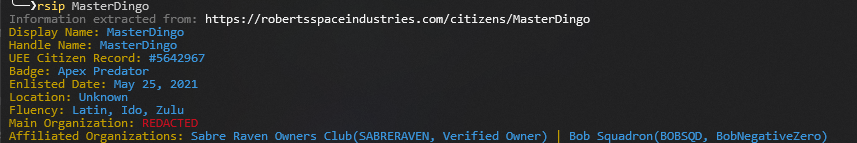

# rsip

Look up any Star Citizen player's public RSI profile from your terminal.

`rsip` fetches a citizen's page on [robertsspaceindustries.com](https://robertsspaceindustries.com) and prints the interesting parts in one colour-coded block: handle, citizen record, badge, enlistment date, location, languages, bio and organization memberships. It is a single PowerShell script with no dependencies.



## What it shows

- Display name and handle
- UEE Citizen Record number
- Badge (Civilian, Apex Predator, ...)
- Enlistment date
- Location and fluency
- Bio (optional)
- Main organization and affiliations, with SID and rank. Organizations the player has set to redacted are marked **REDACTED** in red.

## Requirements

Windows PowerShell 5.1 or PowerShell 7+. Nothing else: no modules, no DLLs.

## Install

1. Download `rsip.ps1` from this repository (or clone it).
2. Put it wherever you like.

If Windows refuses to run it with *"running scripts is disabled"* or because the file was downloaded from the internet, do one of the following once:

```powershell
Unblock-File .\rsip.ps1
```

or start it with the policy bypassed:

```powershell
powershell -ExecutionPolicy Bypass -File .\rsip.ps1 SomeHandle
```

## Usage

```powershell
.\rsip.ps1 SomeHandle          # look up a player
.\rsip.ps1 SomeHandle -b       # also print the bio
.\rsip.ps1                     # no handle given: you will be asked for one
```

| Option      | Description                                                     |
|-------------|-----------------------------------------------------------------|
| `-Bio`, `-b` | Also print the player's bio                                     |
| `-AsObject`  | Return an object instead of text, for use in your own scripts   |

`Get-Help .\rsip.ps1` shows the built-in help.

### Example

```
PS> .\rsip.ps1 MasterDingo -b
Information extracted from: https://robertsspaceindustries.com/citizens/MasterDingo
Display Name: MasterDingo
Handle Name: MasterDingo
UEE Citizen Record: #5642967
Badge: Apex Predator
Enlisted Date: May 25, 2021
Location: Unknown
Fluency: Latin, Ido, Zulu
Bio: You seem somewhat familiar. Have I threatened you before?
Main Organization: REDACTED
Affiliated Organizations: Sabre Raven Owners Club(SABRERAVEN, Verified Owner) | Bob Squadron(BOBSQD, BobNegativeZero)
```

### Use it from scripts

With `-AsObject` the script returns a regular PowerShell object, so you can pipe it anywhere:

```powershell
.\rsip.ps1 MasterDingo -AsObject | ConvertTo-Json

$player = .\rsip.ps1 MasterDingo -AsObject
$player.EnlistedDate
$player.AffiliatedOrganizations.Count
```

Properties: `Url`, `DisplayName`, `HandleName`, `UEECitizenRecord`, `Badge`, `EnlistedDate`, `Location`, `Fluency`, `Bio`, `MainOrganization`, `AffiliatedOrganizations`.

### Run it as `rsip` from anywhere

Add an alias to your PowerShell profile (`notepad $PROFILE`):

```powershell
Set-Alias rsip "C:\path\to\rsip.ps1"
```

Open a new terminal and `rsip SomeHandle` works from any folder.

## How it works

The script downloads the citizen page and its organizations page, then reads the values straight out of the HTML with a handful of patterns. There is no API involved, so if RSI ever restructures their profile pages the values will come back as *Not Found* and the script will print a warning saying so. The patterns live in a few short functions at the top of `rsip.ps1` and are quick to adjust.

Only public information is shown: exactly what anyone sees when opening the profile in a browser.

## License

[GPL-3.0](LICENSE)
